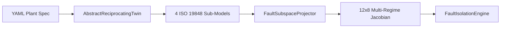

# greybox-ice-twin-showcase

Pure-Python mathematical core for physics-informed reciprocating engine diagnostics. Three components drive the design: polymorphic ISO 19848:2018 / SFI 601 sub-models, orthogonal fault-subspace projection, and multi-regime Jacobian rank conditioning.

Runtime dependencies are minimal (`numpy`, `pydantic`, `pyyaml`). No GPU, JAX stack, or physical engine bus is required to execute tests or demos.

## 1. Operational and Business Problem

Threshold diagnostics fail late. Standard Diagnostic Trouble Codes (DTCs) and alarm limits fire only after large mechanical drift, misfire saturation, or forced limp-home derates. By that point, secondary component damage has already occurred.

Black-box machine learning detectors fail differently. During periodic fleet baseline updates or single-asset retraining, unconstrained regression surrogates absorb gradual degradation directly into learned weights. Cracked crankcase breather hoses, fouled injectors, and scaled heat-exchanger plates merge silently into the statistical baseline.

Out-of-distribution shifts compound the cost. Unconstrained models extrapolate erratically across ambient weather changes, fuel-blend variations, or off-design part loads. High false-alarm rates erode operator trust. Maintenance teams face two expensive penalties: unscheduled propulsion downtime or unnecessary teardown inspections.

Structural separation resolves both failure modes. Conservation equations govern nominal engine behavior, while data-driven surrogates stay mathematically orthogonal to physical fault directions.

## 2. Mathematical and Thermodynamic Formulation

### 2.1 Cycle-Averaged 0D Mean-Value Engine Model (MVEM) and ISO 19848 Polymorphism

The solver implements a cycle-averaged **0D lumped-parameter Mean-Value Engine Model (MVEM)**, not spatially resolved CFD or unsteady pipe-gas dynamics. Four coupled physical sub-models run inside [`AbstractReciprocatingTwin`](src/greybox_showcase/iso19848_twin.py) without conditional branching on engine make or cycle.

YAML configurations bind both reference plants to **ISO 19848:2018** telemetry contracts and **SFI Group 601** taxonomy:

| Sub-Model | SFI Code | BMW N42B20A (4-Stroke Otto) | MAN B&W 6S50ME-C9.7-TII (2-Stroke Diesel) |
| :--- | :---: | :--- | :--- |
| Air path and trapping | `601.11` | Valvetronic lift (`0.3-9.7 mm`) + Double VANOS | Hydraulic VVA (`5.0-120.0 mm`) + scavenge ports |
| Stoichiometric / SFOC balance | `601.21` | Mechanical `3.5 bar` boot-referenced FPR (no rail sensor) | `800 bar` common rail with direct rail sensor |
| Crankshaft harmonics (IAS) | `601.31` | 60-2 target wheel, firing `[1, 3, 4, 2]` | Torsional cylinder balancing, firing `[1, 5, 3, 4, 2, 6]` |
| Thermal balance and fouling | `601.41` | 2-node block/oil (`92 kJ/K`, `18.5 kJ/K`) | Jacket water + cooler (`4.8 MJ/K`, `1.9 MJ/K`) |

One unified kernel executes across the `1.995 L` gasoline engine and the `2,356.2 L` (`10,680 kW` at `127 RPM`) marine prime mover.

- **Compressible Orifice and Trapped Charge (`601.11`).** Breathing combines a $C^\infty$ softplus-regularized Saint-Venant and Wantzel orifice nozzle ($\Pi_{\mathrm{crit}} = 0.5283$ for $\gamma = 1.4$, $\epsilon_\Pi = 10^{-3}$) with cycle-averaged trapped mass ($\dot{m}_{\mathrm{trap}} = f_{\mathrm{fire}} V_{\mathrm{eff}} \rho_{\mathrm{chg}}$) via a $p$-norm series conductance blend ($k_p = 6.0$).
- **Two-Node Thermal Balance (`601.41`).** Coupled coolant and oil enthalpy states evolve through clean heat-transfer conductances $(UA)_{\mathrm{clean}}$ scaled by online fouling factors $\theta_{\mathrm{foul}}(t) = (UA)_{\mathrm{act}}(t)/(UA)_{\mathrm{clean}}$. Values below `0.65` trigger a fouling alert.
- **Stoichiometric / SFOC Mass Balance (`601.21`).** Residuals separate orifice air leaks ($\dot{m}_{\mathrm{leak}} \propto \sqrt{|\Delta P|}$), rail-pressure droop, and per-cylinder injection bias. The BMW N42B20A relies on a mechanical `3.5 bar` (`350 kPa`) boot-referenced returnless regulator without an electronic rail-pressure sensor. Rail-pressure loss (`throttled_mode_fuel_gain = 1.0615`) is therefore inferred from load-dependent trim divergence.
- **Firing-Order Torsional Harmonics (`601.31`).** Angular acceleration spread $\Delta \omega_k$ permutes along firing order and decomposes via discrete Fourier sums into $0.5\text{-order}$, $1.0\text{-order}$, and firing pulsation components. Gate 4 enforces bounds of `0.8 rad/s^2` (automotive) and `0.25 rad/s^2` (marine).

Dimensionless scaling confirms cross-domain parity across three orders of magnitude in displacement. Critical Mach discrepancy equals `0.0`. Strouhal numbers evaluate to `0.9333` versus `0.7500` (ratio `1.2444`), and the cooling timescale ratio is `0.7174`, yielding a transferability score of `0.905`.

### 2.2 Orthogonal Fault-Subspace Projection ($\mathbf{P}_{\mathcal{F}^\perp}$)

Unconstrained surrogates steal fault energy. Training a polynomial or neural residual corrector on raw air-mass errors $r_{\mathrm{raw}}(t) = \dot{m}_{\mathrm{meas}}(t) - \dot{m}_{\mathrm{calc}}(t)$ lets the adaptive term absorb nascent breather leaks or airflow sensor drift.

[`FaultSubspaceProjector`](src/greybox_showcase/orthogonal_projector.py) blocks fault absorption by construction. Three physical fault directions span the basis $\mathbf{F} = [\mathbf{1},\; \dot{\mathbf{m}}_{\mathrm{calc}},\; \sqrt{\max(\Delta \mathbf{P}, 0)/P_{\mathrm{ref}}}] \in \mathbb{R}^{N \times 3}$ with $P_{\mathrm{ref}} = 50{,}000\text{ Pa}$.

Column normalization and twice-iterated reduced QR produce an orthonormal basis $\mathbf{Q}_F \in \mathbb{R}^{N \times r}$ ($r \le 3$) and orthogonal projector $\mathbf{P}_{\mathcal{F}^\perp} = \mathbf{I}_N - \mathbf{Q}_F \mathbf{Q}_F^\top$. Feature matrices $\mathbf{\Phi}(\mathbf{X})$ and raw residuals $\mathbf{r}_{\mathrm{raw}}$ project onto $\mathcal{F}^\perp$ in $\mathcal{O}(Nr)$ time without assembling the $N \times N$ matrix.

At inference, [`OrthogonalPolySurrogate`](src/greybox_showcase/orthogonal_projector.py) strips the least-squares fault projection $\mathbf{f}(\mathbf{x})^\top \mathbf{c}$ ($\mathbf{c} = \mathbf{F}^+\mathbf{\Phi}\mathbf{w}$) from raw surrogate outputs. The resulting correction $\mathbf{g}_\perp$ keeps zero energy in $\mathcal{F}$ ($\|\mathbf{P}_{\mathcal{F}}\mathbf{g}_\perp\|_2 < 10^{-10}$; measured `7.69e-20` in the demo), preserving `100%` of linear fault signatures.

### 2.3 Multi-Regime Observability and Rank Conditioning

Single-regime idle data is unidentifiable. At `700 RPM` Valvetronic micro-lift (`0.35 mm`, `50 mbar` vacuum), vacuum leakage, MAF gain error, MAF zero-offset, and fuel-pressure droop collapse into collinear fuel-trim shifts ($\text{rank} = 4/8$, $\kappa(\tilde{\mathbf{H}}) = \infty$).

Stacking four excitation regimes in [`observability.py`](src/greybox_showcase/observability.py) restores full column rank. Those regimes are `KOEO` (`RPM = 0`), `VALVETRONIC_50MBAR` (`0.35 mm`, `50 mbar`), `ACTIVE_THROTTLED_500MBAR` (`9.7 mm`, `500 mbar`), and `COLD_WARMUP` (part-load cruise, VANOS slew, and thermal warmup).

The stacked $12 \times 8$ Jacobian $\mathbf{H}$ matches central finite differences exactly ($\max|\mathbf{J}_{\mathrm{fd}} - \mathbf{H}| = 0.00$). After column equilibration, $\tilde{\mathbf{H}}$ attains `rank = 8/8` with equilibrated condition number $\kappa(\tilde{\mathbf{H}}) = 6.4131 < 50.0$.

| ID | Fault Mode | SFI | Symmetry | Separating Physical Criterion |
| :---: | :--- | :---: | :---: | :--- |
| `FM-01` | Unmetered air / CCV leak | `601.11` | Symmetric | Vacuum switch `50 -> 500 mbar` scales leak by $\sqrt{10} \approx 3.162\times$ |
| `FM-02` | MAF gain drift | `601.11` | Symmetric | Constant $r_{\mathrm{MAF}} / \dot{m}_{\mathrm{calc}}$, invariant to `50 -> 500 mbar` switch |
| `FM-03` | MAF zero-offset drift | `601.11` | Symmetric | Fails KOEO gate: $V_{\mathrm{HFM}} \notin [0.97, 1.03]\text{ V}$ or MAF $> 0.5\text{ kg/h}$ |
| `FM-04` | Fuel pressure droop | `601.21` | Symmetric | $r_{\mathrm{MAF}} \approx 0$ while symmetric trim rises with fuel demand |
| `FM-05` | Single-injector fouling | `601.21` | Asymmetric | Bank split (`> 3%`) and roughness persist at `9.7 mm` lift |
| `FM-06` | Valvetronic lever wear | `601.11` | Asymmetric | Micro-lift roughness (`> 0.8 rad/s^2` at `0.35 mm`) vanishes at `9.7 mm` |
| `FM-07` | Sticky VANOS solenoid | `601.11` | Symmetric | Error `> 0.8 degCRK` or slew `< 80 degCRK/s` at $T_{\mathrm{oil}} \ge 80^\circ\text{C}$ |
| `FM-08` | Thermostat vs. fouling | `601.41` | None | Stuck thermostat tracks coolant at `PWM = 0`; fouling hits $\theta_{\mathrm{rad}} < 0.65$ |

All eight canonical faults isolate deterministically once multi-regime observations satisfy the SVD rank gate.

## 3. Software Engineering Architecture and Reproducibility

### 3.1 Validation Contracts and Packaging

Every input frame undergoes strict schema validation. [`ISO19848TelemetryFrame`](src/greybox_showcase/iso19848_twin.py) and [`ReciprocatingPlantConfig`](src/greybox_showcase/iso19848_twin.py) enforce physical bounds, SI units, and `Optional` sensors using Pydantic v2 (`ConfigDict`).



Bundled YAML plant configs inside `src/greybox_showcase/_configs/` resolve via `importlib.resources` (`resolve_config_path`), enabling wheel execution outside the repository tree. Runtime dependencies stay restricted to `numpy>=1.26`, `pydantic>=2.6`, and `pyyaml>=6.0` on Python `>=3.11`.

Public scope stays strictly focused. Live KWP2000/K-Line OBD acquisition, ECU symbol tables, and GPU JAX/Diffrax calibration pipelines stay in the private hardware-in-the-loop branch.

### 3.2 Verification and Quickstart

Install the package locally and execute all `26` unit/property tests alongside the CLI demonstration:

```bash
git clone https://github.com/Giorgoskokk06/greybox-ice-twin-showcase.git
cd greybox-ice-twin-showcase

python3 -m venv .venv
source .venv/bin/activate
pip install -e ".[dev]"

pytest -v
python3 scripts/run_showcase_demo.py
```

Executing [`scripts/run_showcase_demo.py`](scripts/run_showcase_demo.py) (with optional `--json`) runs on CPU without GPU acceleration and prints verified metrics:

```text
[1] ISO 19848:2018 / SFI 601 Polymorphic Twin (Zero Code Branching)
  - Automotive : BMW_N42B20A (4-cyl, 4-stroke) -> m_dot = 0.011773 kg/s
  - Maritime   : MAN_BW_6S50ME_C (6-cyl, 2-stroke) -> m_dot = 16.7596 kg/s, fouling=0.58 (alert=True)
  - Similarity : Mach discrepancy = 0.0, Strouhal ratio = 1.2444, score = 0.905

[2] Multi-Regime 8-Fault Observability & SVD Rank Gate
  - Single Regime (Valvetronic 50 mbar) : rank = 4/8, cond = inf
  - Stacked 4-Regime Excitation         : rank = 8/8, cond(H_tilde) = 6.4131 (< 50.0) | PASS=True
  - Finite-Difference Jacobian Parity   : max |J_fd - H| = 0.00e+00

[3] Fault-Subspace Orthogonal Projection P_{F^perp}
  - Idempotence ||P^2 - P||_F           : 4.97e-15
  - Orthogonality ||P F||_F             : 9.27e-15
  - Anti-Masking ||P_F g_perp||_2       : 7.69e-20 (verified=True)

[4] Deterministic Fault Isolation Samples
  - CCV Vacuum Leak (50 -> 500 mbar)    : FM_01_UNMETERED_AIR_CCV_LEAK (scale=3.16x, SFI 601.11)
  - Valvetronic Wear (0.35 -> 9.7 mm)   : FM_06_VALVETRONIC_SHAFT_LEVER_WEAR (CYL_1, SFI 601.11)
```

GitHub Actions CI (`.github/workflows/ci.yml`) runs `pytest -v` and `python scripts/run_showcase_demo.py` across Python `3.11` and `3.12`. Full equations, similarity metrics, and channel mappings reside in [docs/MARITIME_TRANSFERABILITY_ISO19848.md](docs/MARITIME_TRANSFERABILITY_ISO19848.md).

### 3.3 Repository Layout

- `config/` — YAML specs (`bmw_n42b20a.yaml`, `maritime_man_bw_6s50me_c.yaml`, `fault_isolation_matrix.yaml`).
- `src/greybox_showcase/iso19848_twin.py` — Polymorphic 4-submodel 0D MVEM twin.
- `src/greybox_showcase/orthogonal_projector.py` — Reorthogonalized QR projector $\mathbf{P}_{\mathcal{F}^\perp}$ and surrogate.
- `src/greybox_showcase/observability.py` — `12x8` Jacobian, SVD rank gate, and 8-fault isolation engine.
- `src/greybox_showcase/_configs/` — Bundled YAML package resources for wheel distributions.
- `scripts/run_showcase_demo.py` — Deterministic terminal and `--json` verification script.
- `tests/` — `26` unit, Jacobian parity, packaging, and CLI smoke tests.
- `CITATION.cff`, `LICENSE`, `NOTICE` — CFF 1.2.0 metadata, PolyForm Noncommercial 1.0.0 license, and notices.

## 4. Author, Citation, and License

Giorgos Kokkaliaris — Department of Mechanical Engineering, University of West Attica (UNIWA). Citation metadata is maintained in [CITATION.cff](CITATION.cff) (`version: 0.1.1`).

This software is released under the **[PolyForm Noncommercial License 1.0.0](LICENSE)** (see [NOTICE](NOTICE) for trademark disclaimers). Academic research, university evaluation, and personal educational or portfolio execution are permitted, while commercial usage requires a separate written license from the author.
