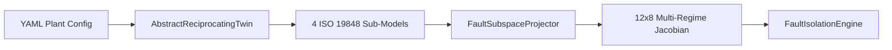

# greybox-ice-twin-showcase

Pure-Python mathematical core of a physics-informed grey-box digital twin for reciprocating engines, built around three ideas:

1. **ISO 19848:2018 / SFI 601 polymorphism** — the same four thermodynamic sub-models instantiate a 2.0 L automotive 4-cylinder engine (`BMW N42B20A`) and a 2,356 L 2-stroke marine diesel (`MAN B&W 6S50ME-C`) directly from YAML without branching on engine type.
2. **Orthogonal fault-subspace projection** — residual surrogates are projected onto the complement of the physical fault basis (`P_{F^perp} = I - Q_F Q_F^T`) so data-driven terms cannot absorb real mechanical defects (`||P_F g_perp||_2 = 4.94e-20`).
3. **Multi-regime observability** — steady-state idle alone is rank-deficient (`rank = 4/8`), so stacking four excitation regimes yields a full-rank `12 x 8` sensitivity matrix (`rank = 8/8`, equilibrated `cond(H_tilde) = 6.4131 < 50.0`).

Runtime dependencies are `numpy`, `pydantic`, and `pyyaml`. No GPU, JAX, or vehicle hardware is required to run the tests or demo.

## Quickstart

```bash
git clone https://github.com/Giorgoskokk06/greybox-ice-twin-showcase.git
cd greybox-ice-twin-showcase

python3 -m venv .venv
source .venv/bin/activate
pip install -e ".[dev]"

pytest -v
python3 scripts/run_showcase_demo.py
```

Example output (`~0.03 s` on CPU):

```text
[1] ISO 19848:2018 / SFI 601 Polymorphic Twin (Zero Code Branching)
  - Automotive : BMW_N42B20A (4-cyl, 4-stroke) -> m_dot = 0.011773 kg/s
  - Maritime   : MAN_BW_6S50ME_C (6-cyl, 2-stroke) -> m_dot = 16.7596 kg/s, fouling=0.58 (alert=True)
  - Similarity : Mach discrepancy = 0.0, Strouhal ratio = 1.2444, score = 0.905

[2] Multi-Regime 8-Fault Observability & SVD Rank Gate
  - Single Regime (Valvetronic 50 mbar) : rank = 4/8, cond = inf
  - Stacked 4-Regime Excitation         : rank = 8/8, cond(H_tilde) = 6.4131 (< 50.0) | PASS=True
  - Finite-Difference Jacobian Parity   : max |J_fd - H| = 0.00e+00

[3] Fault-Subspace Orthogonal Projection P_{F^perp}
  - Idempotence ||P^2 - P||_F           : 6.56e-15
  - Orthogonality ||P F||_F             : 6.28e-15
  - Anti-Masking ||P_F g_perp||_2       : 4.94e-20 (verified=True)

[4] Deterministic Fault Isolation Samples
  - CCV Vacuum Leak (50 -> 500 mbar)    : FM_01_UNMETERED_AIR_CCV_LEAK (scale=3.16x, SFI 601.11)
  - Valvetronic Wear (0.35 -> 9.7 mm)   : FM_06_VALVETRONIC_SHAFT_LEVER_WEAR (CYL_1, SFI 601.11)
```

## Architecture



`AbstractReciprocatingTwin` (`src/greybox_showcase/iso19848_twin.py`) maps both plants through identical SFI Group 601 contracts:

| Sub-Model | SFI Code | BMW N42B20A (Automotive) | MAN B&W 6S50ME-C (Maritime) |
| :--- | :---: | :--- | :--- |
| Air path & trapping | `601.11` | Valvetronic VVL + Double VANOS | Hydraulic VVA + scavenge ports |
| Fuel / stoichiometric balance | `601.21` | Dual-bank lambda + returnless FPR | SFOC + common-rail fuel pressure |
| Crankshaft harmonics | `601.31` | 60-2 flywheel cylinder roughness | Torsional IAS cylinder balancing |
| Thermal balance & fouling | `601.41` | 2-node block/oil model (`92 kJ/K`) | Jacket water & plate cooler (`4.8 MJ/K`) |

Full derivations and non-dimensional similarity analysis are in [docs/MARITIME_TRANSFERABILITY_ISO19848.md](docs/MARITIME_TRANSFERABILITY_ISO19848.md).

## Multi-regime fault isolation

At a single operating point, vacuum leaks, MAF drift, and fuel pressure droop produce indistinguishable trim signatures (`rank = 4/8`). Stacking four regimes (`KOEO`, `VALVETRONIC_50MBAR`, `ACTIVE_THROTTLED_500MBAR`, `COLD_WARMUP`) separates all eight fault modes:

| ID | Fault Mode | SFI | Symmetry | Separating signature |
| :---: | :--- | :---: | :---: | :--- |
| `FM-01` | Unmetered air / CCV leak | `601.11` | Symmetric | Scales by `sqrt(10) = 3.162x` between `50` and `500 mbar` vacuum |
| `FM-02` | MAF gain drift | `601.11` | Symmetric | Multiplicative with airflow, invariant to vacuum toggle |
| `FM-03` | MAF zero-offset drift | `601.11` | Symmetric | Non-zero reading at KOEO (`RPM = 0`, outside `0.97-1.03 V`) |
| `FM-04` | Fuel pressure droop | `601.21` | Symmetric | `r_MAF ~ 0` while trim rises monotonically with fuel flow |
| `FM-05` | Single-injector fouling | `601.21` | Asymmetric | Bank trim split + cylinder roughness persists at `9.7 mm` lift |
| `FM-06` | Valvetronic shaft/lever wear | `601.11` | Asymmetric | Roughness at `0.35 mm` micro-lift vanishes at `9.7 mm` lift |
| `FM-07` | Sticky VANOS solenoid | `601.11` | Symmetric | Cam tracking error `> 0.8 deg` or slew `< 80 deg/s` at `T_oil > 80 C` |
| `FM-08` | Thermostat open vs. fouling | `601.41` | None | Open thermostat tracks `T_coolant` at `PWM = 0`; fouling gives `theta_rad < 0.65` |

## Scope note

This public repository contains the self-contained mathematical core, configs, CLI demo, and 26 unit tests (`src/greybox_showcase/`, `config/`, `tests/`). Live in-vehicle KWP2000/K-Line OBD acquisition, ECU symbol tables, lakehouse ingestion, and GPU JAX/Diffrax calibration runners live in the private hardware-in-the-loop branch.

## Layout

```text
config/
  bmw_n42b20a.yaml                # 4-cylinder automotive plant spec
  maritime_man_bw_6s50me_c.yaml   # 6-cylinder 2-stroke marine diesel spec
  fault_isolation_matrix.yaml     # 8-fault residual definitions and SFI codes
src/greybox_showcase/
  iso19848_twin.py                # Polymorphic 4-submodel digital twin
  orthogonal_projector.py         # Reorthogonalized QR projector P_{F^perp}
  observability.py                # 12x8 Jacobian, SVD rank gate, isolation engine
  _configs/                       # Bundled YAML package data for wheel installs
scripts/
  run_showcase_demo.py            # End-to-end verification printout
tests/                            # 26 pytest cases (math, parity, packaging, CLI smoke)
CITATION.cff                      # CFF 1.2.0 academic citation metadata
LICENSE                           # PolyForm Noncommercial License 1.0.0
NOTICE                            # Trademark disclaimer & third-party notices
```

## Author & License

Giorgos Kokkaliaris — Department of Mechanical Engineering, University of West Attica (UNIWA).  
Released under the **[PolyForm Noncommercial License 1.0.0](LICENSE)** (see also [NOTICE](NOTICE) and [CITATION.cff](CITATION.cff)).

Academic research, university evaluation, and personal educational or portfolio execution are permitted under the PolyForm Noncommercial License 1.0.0. Commercial use requires a separate written license from the author.
