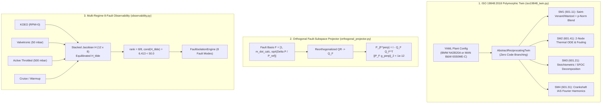
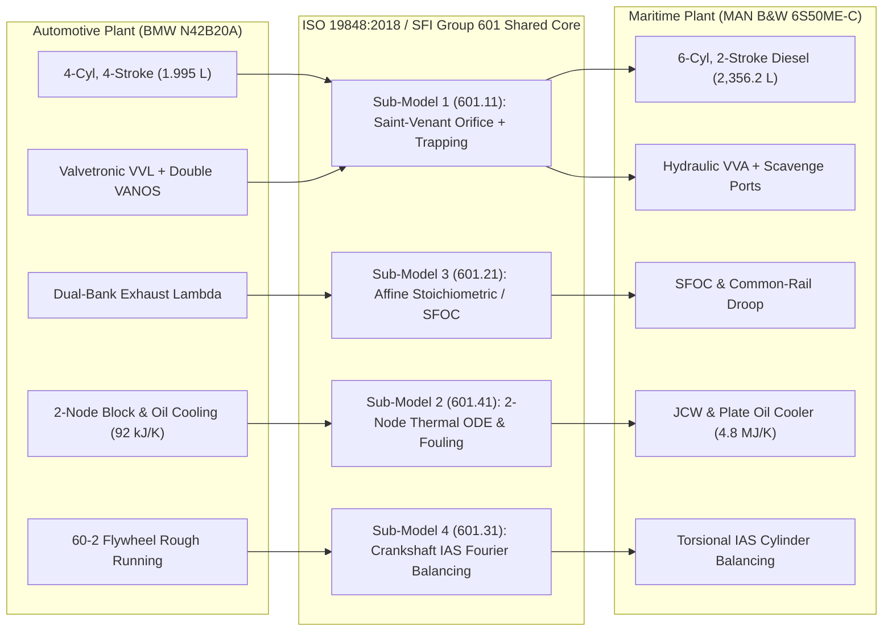

# `greybox-ice-twin-showcase` — Physics-Informed Grey-Box Digital Twin Core

[](LICENSE)
[](pyproject.toml)
[](docs/MARITIME_TRANSFERABILITY_ISO19848.md)
[](.github/workflows/ci.yml)

> **Physics-Informed Grey-Box Digital Twin Core:** Orthogonal Fault-Subspace Projection ($\mathbf{P}_{\mathcal{F}^\perp}$, $\|\mathbf{P}_{\mathcal{F}} g_\perp\|_2 = 4.94 \times 10^{-20}$), 8-Fault Multi-Regime Observability ($12 \times 8$ Jacobian, $\text{rank} = 8/8$, $\text{cond}(\tilde{\mathbf{H}}) = 6.4131 < 50.0$), and Zero-Code-Branching **ISO 19848:2018** Automotive-to-Maritime Transferability (**BMW N42B20A 4-Cyl** $\leftrightarrow$ **MAN B&W 6S50ME-C Marine Diesel**).

---

## 1. Scope

This repository is the self-contained mathematical and ISO 19848 core (18 files, 22 `pytest` tests, `numpy`/`pydantic`/`pyyaml` only) extracted from the broader `greybox-ice-twin` research project:

- **Included here (`scripts/run_showcase_demo.py` runs in ~`0.03 s`):**
  - `AbstractReciprocatingTwin` (**ISO 19848:2018 / SFI Group 601** polymorphic 4-subsystem engine)
  - `FaultSubspaceProjector` & `OrthogonalPolySurrogate` ($\mathbf{P}_{\mathcal{F}^\perp} = \mathbf{I} - \mathbf{Q}_{\mathcal{F}}\mathbf{Q}_{\mathcal{F}}^T$, $\|\mathbf{P}_{\mathcal{F}} g_\perp\|_2 = 4.94 \times 10^{-20}$)
  - Multi-Regime 8-Fault Sensitivity/Observability Matrix ($12 \times 8$ Jacobian, $\text{rank} = 8/8$, $\text{cond}(\tilde{\mathbf{H}}) = 6.4131$) & `FaultIsolationEngine`
  - 22 `pytest` unit/smoke tests and single-command CLI demo (`scripts/run_showcase_demo.py`)
- **Kept in the broader private research repository (not in this showcase):**
  - Live in-vehicle KWP2000/K-Line OBD-II hardware acquisition, ECU binary symbol tables, Parquet/DuckDB/Supabase pipelines, and GPU JAX/Diffrax stiff ODE/UKF calibration runners.

---

## 2. System Architecture & Multi-Regime Observability



---

## 3. The 4 Pre-Training Physical Qualification Gates

| Qualification Gate | Physical Mechanism & Mathematical Boundary | Fault Addressed |
| :--- | :--- | :--- |
| **Gate 1: Stoichiometric & KOEO** | $\|F_{\text{total}}\| < 0.035$, $\|F_{\text{B1}} - F_{\text{B2}}\| < 0.020$, $V_{\text{HFM}}(\text{RPM}=0) \in [0.97, 1.03]\text{ V}$ | CCV vacuum leaks, FPR droop, MAF offset/gain drift |
| **Gate 2: Valvetronic Tracking** | $\|L_{\text{vvt,target}} - L_{\text{vvt,actual}}\| < 0.05\text{ mm}$ ($50\text{ }\mu\text{m}$), $t_{90\%} < 120\text{ ms}$ | Eccentric shaft & intermediate lever wear (`FM_06`) |
| **Gate 3: Double VANOS Tracking** | Steady error $< 0.8^\circ\text{CRK}$, Slew rate $> 80.0^\circ\text{CRK/s}$ at $T_{\text{oil}} > 80.0^\circ\text{C}$ | Sticky VANOS solenoids or oil sludge (`FM_07`) |
| **Gate 4: Cylinder Symmetry** | Cross-cylinder roughness spread $\max_k \|\Delta \omega_k\| < 0.8\text{ rad/s}^2$ (4-cyl) / $0.25\text{ rad/s}^2$ (marine) | Single-injector coking, compression loss, or misfire |

---

## 4. Multi-Regime 8-Fault Observability Matrix (`cond(H_tilde) = 6.4131`)

A single steady-state idle regime (`VALVETRONIC_50MBAR`) is rank-deficient (`rank = 4/8`, `cond = inf`). Stacking the 4 excitation regimes (`KOEO`, `VALVETRONIC_50MBAR`, `ACTIVE_THROTTLED_500MBAR`, `COLD_WARMUP`) yields a $12 \times 8$ Jacobian with full column rank (`8/8`) and $\text{cond}(\tilde{\mathbf{H}}) = 6.4131 < 50.0$:

| ID | Fault Mode | SFI Code | Bank Symmetry | Deterministic Disambiguation Rule |
| :---: | :--- | :---: | :---: | :--- |
| **FM-01** | Unmetered Air / CCV Valve or Hose Leak | `601.11` | `SYMMETRIC` | Air leak scales by $\sqrt{10} \approx 3.162\times$ when toggling $50 \to 500\text{ mbar}$ vacuum. |
| **FM-02** | HFM5 MAF Gain Contamination / Aging | `601.11` | `SYMMETRIC` | Multiplicative error proportional to airflow; invariant to vacuum switch. |
| **FM-03** | HFM5 MAF Zero-Offset Drift | `601.11` | `SYMMETRIC` | Observable at Stage 1 KOEO ($\text{RPM}=0$): $V_{\text{HFM}} \notin [0.97, 1.03]\text{ V}$. |
| **FM-04** | Fuel Pressure Drop / Filter Regulator | `601.21` | `SYMMETRIC` | $r_{\text{MAF}} \approx 0$ while fuel trims spike monotonically with $\dot{m}_{\text{fuel}}$. |
| **FM-05** | Single-Injector Varnish / Spray Fouling | `601.21` | `ASYMMETRIC` | Asymmetric bank trim ($|F_{\text{B1}} - F_{\text{B2}}| > 0.030$) + roughness **persists at $9.7\text{ mm}$ lift**. |
| **FM-06** | Valvetronic Eccentric Shaft / Lever Wear | `601.11` | `ASYMMETRIC` | Asymmetric roughness at micro-lift ($0.35\text{ mm}$) that **vanishes at $9.7\text{ mm}$ lift**. |
| **FM-07** | Sticky VANOS Solenoid / Cam Phasing Retard | `601.11` | `SYMMETRIC` | Gate 3 violation: error $> 0.8^\circ\text{CRK}$ or slew $< 80^\circ\text{CRK/s}$ at $T_{\text{oil}} > 80^\circ\text{C}$. |
| **FM-08** | Map-Thermostat Stuck Open vs. Radiator Fouling | `601.41` | `NONE` | Stuck open: $T_{\text{rad,out}}$ tracks $T_{\text{coolant}}$ at $\text{PWM}=0$; Fouling: $\theta_{\text{rad}} < 0.65$. |

---

## 5. ISO 19848:2018 Automotive $\leftrightarrow$ Maritime Isomorphism



See the full mathematical whitepaper in [`docs/MARITIME_TRANSFERABILITY_ISO19848.md`](docs/MARITIME_TRANSFERABILITY_ISO19848.md).

---

## 6. Quickstart

```bash
git clone https://github.com/<your-username>/greybox-ice-twin-showcase.git
cd greybox-ice-twin-showcase

python -m venv .venv
source .venv/bin/activate
pip install -e ".[dev]"

# Run the 22 unit and smoke tests
pytest -v

# Run the CLI mathematical showcase (~0.03 s)
python scripts/run_showcase_demo.py
```

---

## 7. Author & License

- **Author:** **Giorgos Kokkaliaris** — Mechanical Engineering, **University of West Attica (UNIWA)**
- **License:** [MIT License](LICENSE)
