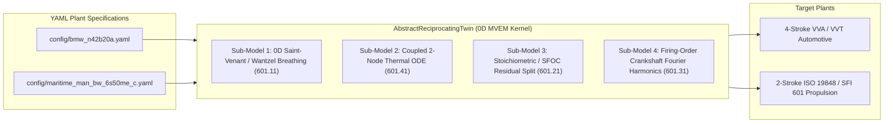

# Maritime Digital Twin Transferability and ISO 19848 / SFI Group 601 Isomorphism

Reference whitepaper for [`src/greybox_showcase/iso19848_twin.py`](../src/greybox_showcase/iso19848_twin.py). Governing standards are **ISO 19848:2018** (*Ships and marine technology — Specification for data structures for data from shipboard machinery and equipment*) and **SFI Group 601** (*Diesel Engine Propulsion Plant / Reciprocating Machinery*).

---

## 1. Modeling Scope and Cross-Domain Isomorphism

Thermodynamics stays invariant across scale. `greybox-ice-twin-showcase` formulates a cycle-averaged **0D lumped-parameter Mean-Value Engine Model (MVEM)**, avoiding spatially resolved CFD meshes and unsteady pipe-gas dynamics. Both plants execute inside [`AbstractReciprocatingTwin`](../src/greybox_showcase/iso19848_twin.py) with zero conditional branching on engine make, cylinder count, or stroke cycle.

- **Automotive Testbed (`BMW_N42B20A`).** This 4-stroke, 4-cylinder naturally aspirated Otto engine displaces `1.995 L` (`84.0 mm` bore, `90.0 mm` stroke, `10.2` compression ratio) and delivers `105.0 kW` at `6,000 RPM` under Bosch ME9.2 control. Intake charge control pairs Valvetronic early intake valve closing (`0.3-9.7 mm` lift) with Double VANOS cam phasing and dual-bank exhaust stoichiometry.
- **Maritime Propulsion Plant (`MAN_BW_6S50ME_C`).** This 2-stroke crosshead low-speed marine diesel displaces `2,356.2 L` (`500 mm` bore, `2,000 mm` stroke, `19.5` compression ratio) and produces `10,680 kW` at `127 RPM` under an ECS/MPC controller. Breathing combines uniflow scavenge liner ports (`320 kPa` receiver pressure) with a hydraulic exhaust poppet valve (`5.0-120.0 mm` VVA lift).

One solver evaluates both engines. External YAML files bind geometry, thermal capacitances, fault gates, and ISO 19848 channel identifiers.

---

## 2. Four-Subsystem Structural Mapping

One schema binds both plants. Subsystems align under SFI Group 601 while YAML configs swap geometry and sensor tables.

| Physical Subsystem | SFI Code | BMW N42B20A Realization | MAN B&W 6S50ME-C9.7-TII Realization | Shared 0D Kernel |
| :--- | :---: | :--- | :--- | :--- |
| Valve actuation and trapping | `601.11` | Valvetronic intake (`0.3-9.7 mm`) + VANOS; $C_d = 0.72$, $\eta_{v,0} = 0.92$ | Hydraulic exhaust VVA (`5.0-120.0 mm`) + ports; $C_d = 0.68$, $\eta_{v,0} = 0.95$ | Smooth 0D Saint-Venant / Wantzel nozzle blended with trapped charge ($k_p = 6.0$) |
| Thermal balance and fouling | `601.41` | `92 kJ/K` block/coolant, `18.5 kJ/K` oil, `1,650 W/K` radiator | `4.8 MJ/K` jacket water, `1.9 MJ/K` lube oil, `120 kW/K` plate cooler | Coupled 2-node enthalpy ODE tracking $\theta_{\mathrm{foul}} = (UA)_{\mathrm{act}}/(UA)_{\mathrm{clean}}$ |
| Fuel metering and injection | `601.21` | Mechanical `3.5 bar` boot-referenced FPR (no rail sensor), dual-bank $\lambda$ | `800 bar` common rail with direct sensor, VIT timing, SFOC balance | Linearized split across vacuum leaks, rail droop, and injector bias |
| Crankshaft IAS harmonics | `601.31` | 60-2 wheel, firing `[1, 3, 4, 2]`, Gate 4 `< 0.8 rad/s^2` | Torsional pickup, firing `[1, 5, 3, 4, 2, 6]`, Gate 4 `< 0.25 rad/s^2` | Firing-sequence discrete Fourier harmonics and balancing trim |

---

## 3. Subsystem Mathematical Formulations

### 3.1 Sub-Model 1: 0D Compressible Orifice Flow and Trapped Charge (`601.11`)

This kernel solves **0D quasi-steady isentropic flow**. Unsteady pipe acoustics stay outside the white-box equations. An orthogonal surrogate in $\mathcal{F}^\perp$ learns runner pulsations without masking air leaks.

Choking bounds peak mass flux. For diatomic gas ($\gamma = 1.4$), sonic flow occurs at $\Pi_{\mathrm{crit}} = (2/(\gamma + 1))^{\gamma/(\gamma - 1)} \approx 0.5283$. To preserve $C^\infty$ smoothness across the sonic transition, raw pressure ratio $\Pi = p_{\mathrm{down}}/p_{\mathrm{up}} \in [10^{-4}, 0.9999]$ passes through a softplus floor ($\epsilon_\Pi = 10^{-3}$).

$$\tilde{\Pi}(\Pi) = \Pi_{\mathrm{crit}} + \frac{1}{2}\left((\Pi - \Pi_{\mathrm{crit}}) + \sqrt{(\Pi - \Pi_{\mathrm{crit}})^2 + \epsilon_\Pi^2}\right)$$

Lift proxies fill missing cylinder transducers. When `downstream_cylinder_pressure_pa` is absent, pressure drop approximates as $p_{\mathrm{down}} = p_{\mathrm{up}}(0.35 + 0.60 \cdot \mathrm{clip}(L/L_{\max}, 0.02, 1.0))$.

Total curtain area equals $A_{\mathrm{tot}} = N_{\mathrm{cyl}} N_{\mathrm{val}} \pi D_v L_v$. Firing rate $f_{\mathrm{fire}} = \frac{N_{\mathrm{RPM}}}{60(S_{\mathrm{cyc}}/2)}N_{\mathrm{cyl}}$ and effective volume $V_{\mathrm{eff}} = \frac{V_d}{N_{\mathrm{cyl}}}\eta_{v,0}$ govern displacement ingestion across crank cycles. Orifice and trapped limits blend via a $p$-norm ($k_p = 6.0$).

$$\tilde{\Psi}(\Pi) = \sqrt{\frac{2\gamma}{\gamma-1}\left(\tilde{\Pi}^{\frac{2}{\gamma}} - \tilde{\Pi}^{\frac{\gamma+1}{\gamma}}\right)}, \quad \dot{m}_{\mathrm{orif}} = C_d A_{\mathrm{tot}} \frac{p_{\mathrm{up}}}{\sqrt{R T_{\mathrm{up}}}}\tilde{\Psi}(\Pi), \quad \dot{m}_{\mathrm{trap}} = f_{\mathrm{fire}} V_{\mathrm{eff}} \frac{p_{\mathrm{up}}}{R T_{\mathrm{up}}}$$

Series blending yields $\dot{m}_{\mathrm{calc}} = (\dot{m}_{\mathrm{orif}}^{-k_p} + \dot{m}_{\mathrm{trap}}^{-k_p})^{-1/k_p}$. Breathing residual equals $r_{\mathrm{MAF}} = \dot{m}_{\mathrm{meas}} - \dot{m}_{\mathrm{calc}}$. Both plants execute identical arithmetic in `evaluate_submodel1_breathing`.

### 3.2 Sub-Model 2: Coupled Two-Node Thermal ODE and Heat-Exchanger Fouling (`601.41`)

Two thermal nodes govern block cooling. Coolant temperature $T_c$ and oil temperature $T_o$ evolve through lumped capacitances $C_{\mathrm{th,c}}$ and $C_{\mathrm{th,o}}$.

$$C_{\mathrm{th,c}} \frac{dT_c}{dt} = \dot{Q}_{\mathrm{in,c}} - \dot{Q}_{\mathrm{cool}} - \dot{Q}_{\mathrm{oil}} - \dot{Q}_{\mathrm{amb,c}}, \qquad C_{\mathrm{th,o}} \frac{dT_o}{dt} = \dot{Q}_{\mathrm{in,o}} + \dot{Q}_{\mathrm{oil}} - \dot{Q}_{\mathrm{amb,o}}$$

Scale deposits degrade core conductance monotonically. Heat rejection varies with pump flow fractions $u_c, u_o \in [0.05, 1.0]$ and online fouling factors $\theta_c, \theta_o \in [0.0, 1.2]$.

$$\dot{Q}_{\mathrm{cool}} = \theta_c (UA)_{\mathrm{c,clean}} u_c \max(T_c - T_{\mathrm{sink}}, 0), \qquad \dot{Q}_{\mathrm{oil}} = \theta_o (UA)_{\mathrm{o,clean}} u_o \max(T_o - T_c, -50)$$

Unmeasured combustion heat defaults to $\dot{Q}_{\mathrm{in,c}} = 0.28\,\dot{m}_f\,\mathrm{LHV}$ and $\dot{Q}_{\mathrm{in,o}} = 0.08\,\dot{Q}_{\mathrm{in,c}}$. Zero fuel yields zero heat. During deceleration fuel cut-off (`fuel_mass_flow_kg_s == 0.0`), thermal input drops to zero instead of using stoichiometric air proxies. Values below `0.65` trigger `fouling_alert = True`.

### 3.3 Sub-Model 3: Stoichiometric / SFOC Balance and Sensor Boundary (`601.21`)

Fuel anomalies obey a linear residual decomposition in `evaluate_submodel3_fuel_trim`.

$$\Delta F_{\mathrm{res}} = \frac{\dot{m}_{\mathrm{leak}}}{\dot{m}_{\mathrm{air}}} - \frac{1}{2}\left(\frac{P_{\mathrm{rail}} - P_{\mathrm{rail,nom}}}{P_{\mathrm{rail,nom}}}\right) + \frac{1}{N_{\mathrm{cyl}}}\sum_{k=1}^{N_{\mathrm{cyl}}}\delta_{f,k}$$

Unmetered leakage scales as $\dot{m}_{\mathrm{leak}} = C_{\mathrm{leak}}\sqrt{|P_{\mathrm{amb}} - P_{\mathrm{up}}|}$ ($C_{\mathrm{leak}} = 2.5 \times 10^{-6}$). Cylinder bias follows centered roughness via $\delta_{f,k} = -0.05(\Delta\omega_k - \overline{\Delta\omega})$.

Rail instrumentation splits the two plants. On the BMW N42B20A, a mechanical `3.5 bar` (`350 kPa`) boot-referenced returnless fuel pressure regulator operates without an electronic rail-pressure transducer (`fuel_rail_pressure_pa = None`, `throttled_mode_fuel_gain = 1.0615`), leaving pressure drop unobserved at single steps. Conversely, the MAN B&W 6S50ME-C9.7-TII monitors its `800 bar` (`80 MPa`) common rail directly, returning droop `-0.10` during a `72 MPa` excursion.

### 3.4 Sub-Model 4: Crankshaft IAS and Firing-Order Fourier Harmonics (`601.31`)

Firing order dictates harmonic attribution. Cylinder accelerations $\mathbf{y} \in \mathbb{R}^{N_{\mathrm{cyl}}}$ permute into firing sequence $y_{\mathrm{seq}}[m] = y[\mathcal{O}_{\mathrm{fire}}[m] - 1]$ at cycle phases $\phi_m = 2\pi m / N_{\mathrm{cyl}}$.

$$A_k = \frac{2}{N_{\mathrm{cyl}}}\sum_{m=0}^{N_{\mathrm{cyl}}-1} y_{\mathrm{seq}}[m]\cos(k\phi_m), \qquad B_k = \frac{2}{N_{\mathrm{cyl}}}\sum_{m=0}^{N_{\mathrm{cyl}}-1} y_{\mathrm{seq}}[m]\sin(k\phi_m)$$

Stroke count sets harmonic output keys. In 4-stroke plants, $k = 1$ gives `order_0_5` (camshaft cycle misfire or Valvetronic wear) and $k = 2$ gives `order_1_0` (bank differential on `[1, 3, 4, 2]`). In 2-stroke plants, $k = 1$ gives `order_1_0` (rotational imbalance) and $k = 2$ gives `order_2_0`, while `order_firing` tracks root-mean-square spread around $\bar{y}_{\mathrm{seq}}$.

---

## 4. ISO 19848:2018 Standardized Channel Registry

Telemetry normalizes to SI units before evaluation. Channel URIs lock physical units across heterogeneous ECU and vessel buses.

| Logical Key | ISO 19848 Short ID | SFI | Unit | BMW Native | MAN B&W Native |
| :--- | :--- | :---: | :---: | :--- | :--- |
| `engine_speed` | `/Propulsion/MainEngine/EngineSpeed` | `601.31` | `rpm` | `engine_speed_rpm` | `me_rpm` |
| `manifold_pressure` | `/Propulsion/MainEngine/ScavengeAirPressure` | `601.11` | `Pa` | `p_map` | `p_scav` |
| `charge_air_temperature` | `/Propulsion/MainEngine/ScavengeAirTemperature` | `601.11` | `K` | `t_iat` | `t_scav` |
| `mass_air_flow` | `/Propulsion/MainEngine/ScavengeAirMassFlow` | `601.11` | `kg/s` | `m_dot_air` | `m_dot_scav` |
| `valve_lift` | `/Propulsion/MainEngine/ExhaustValveLift` | `601.11` | `m` | `l_vvt` | `vva_lift` |
| `coolant_temperature` | `/Propulsion/MainEngine/JacketWaterTemp` | `601.41` | `K` | `t_coolant` | `t_jcw_out` |
| `oil_temperature` | `/Propulsion/MainEngine/LubeOilTemp` | `601.41` | `K` | `t_oil` | `t_lube_oil` |
| `fuel_rail_pressure` | `/Propulsion/MainEngine/FuelRailPressure` | `601.21` | `Pa` | `p_fuel_rail` *(absent)* | `p_rail_high` |
| `fuel_mass_flow` | `/Propulsion/MainEngine/FuelOilConsumption` | `601.21` | `kg/s` | `m_dot_fuel` | `m_dot_hfo` |
| `crankshaft_ias_roughness` | `/Propulsion/MainEngine/IASRoughness` | `601.31` | `rad/s^2` | `ias_cyl` | `ias_cyl` |

---

## 5. Dimensionless Similarity and Transfer Boundaries

`compute_dimensionless_similarity` checks scaling parity at cruise speeds (`2,400 RPM` automotive vs. `88.9 RPM` marine).

- **Critical Mach Parity.** Discrepancy in $\Pi_{\mathrm{crit}} = 0.5283$ equals `0.000`.
- **Strouhal Similarity.** Breathing frequency ratio $St = f_{\mathrm{fire}} D_{\mathrm{bore}} / \bar{v}_p$ yields `0.9333` versus `0.7500` (ratio `1.2444`, transferability score `0.9050`).
- **Thermal Cooling Rate Scale.** Clean conductance ratios $(UA)_{\mathrm{c,clean}} / C_{\mathrm{th,c}}$ equal `0.017935 s^-1` and `0.025000 s^-1` (ratio `0.7174`).
- **Firing Symmetry Parity.** Even cylinder counts across both plants yield parity `1.0`.

Transferability stops at physical boundaries. Scavenging bypass breaks 4-stroke assumptions. Uniflow 2-stroke scavenging permits fresh charge short-circuiting into the exhaust receiver during port-and-valve overlap, requiring dedicated scavenge-bypass calibration on marine vessels. Active vacuum switching (`50 -> 500 mbar`) applies only to throttled engines; unthrottled diesels substitute Variable Injection Timing (VIT) sweeps, VTG modulation, and common-rail pressure diagnostics. Finally, a 0D MVEM treats manifolds as lumped control volumes. Acoustic runner resonance stays outside the physical model and belongs to the orthogonal surrogate in $\mathcal{F}^\perp$.

Execution steps and multi-regime Jacobian rank results appear in [README.md](../README.md).
