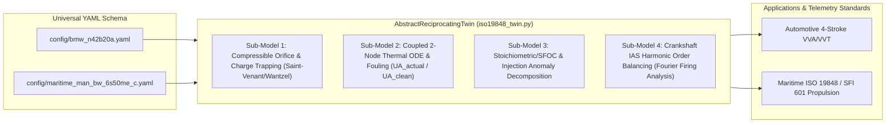

# Maritime Digital Twin Transferability & ISO 19848 / SFI Group 601 Isomorphism

**Document Reference:** `docs/MARITIME_TRANSFERABILITY_ISO19848.md`  
**Governing Standard:** ISO 19848:2018 (*Ships and marine technology — Specification for data structures for data from shipboard machinery and equipment*)  
**Taxonomy Standard:** SFI Group 601 (*Diesel Engine Propulsion Plant / Reciprocating Machinery*)  
**Core Implementation:** [`src/greybox_showcase/iso19848_twin.py`](../src/greybox_showcase/iso19848_twin.py)

---

## 1. Cross-Domain Isomorphism

`greybox-ice-twin-showcase` defines a 1-to-1 mathematical mapping between two reciprocating engines:
1. **Automotive Reference Twin:** BMW E46 318i N42B20A (4-stroke, 4-cylinder, $1.995\text{ L}$, Valvetronic VVL + Double VANOS, Dual-Bank split exhaust).
2. **Maritime Propulsion Reference Twin:** MAN B&W **6S50ME-C9.7-TII** (2-stroke crosshead, 6-cylinder, $2,356.2\text{ L}$ displacement, bore $500\text{ mm}$, stroke $2,000\text{ mm}$, rated at $10,680\text{ kW}$ @ $127\text{ RPM}$).

Both plants are abstracted through **ISO 19848:2018** data structures and **SFI Group 601** component classifications. They instantiate and execute through the same Python class (`AbstractReciprocatingTwin`) with **zero code branching on engine make or model**.

---

## 2. 4-Subsystem Mathematical Isomorphism

| Physical Subsystem | Automotive Manifestation (BMW N42B20A) | Maritime Propulsion Manifestation (MAN B&W 6S50ME-C) | Shared Governing Equations & Estimators | SFI Group 601 Code |
| :--- | :--- | :--- | :--- | :--- |
| **1. Variable Valve Actuation & Charge Trapping** | Valvetronic variable intake lift ($L_{\text{vvt}} \in [0.3, 9.7]\text{ mm}$) + Double VANOS cam phasing. | Hydraulic-Electronic Exhaust Valve Actuation (VVA) + scavenge port opening + Miller-cycle closing. | **Saint-Venant & Wantzel Compressible Orifice Flow** $\tilde{\Psi}(\Pi)$ coupled with cylinder trapping volume $V_{\text{eff}}$ and $p$-norm conductance blend ($k_p = 6.0$). | `601.11` *(Cylinder Covers & Valve Gear)* |
| **2. Coupled 2-Node Thermal ODE & Fouling Estimator** | 2-Node Block/Coolant ($C_{\text{th,c}} = 92\text{ kJ/K}$) & Sump Oil ($C_{\text{th,o}} = 18.5\text{ kJ/K}$). | Central Freshwater Cooling, Jacket Cooling Water (JCW, $C_{\text{th,c}} = 4.8\text{ MJ/K}$) & Lube Oil Cooler ($C_{\text{th,o}} = 1.9\text{ MJ/K}$). | **Coupled Enthalpy Balance ODE** with online parameter tracking of overall heat transfer conductance degradation $\theta_{\text{fouling}}(t) = \frac{(UA)_{\text{actual}}(t)}{(UA)_{\text{clean}}}$. | `601.41` *(Cooling & Lubricating Systems)* |
| **3. Stoichiometric / SFOC & Injection Anomaly** | Dual-bank wideband trims, unmetered vacuum leak, & returnless $3.5\text{ bar}$ FPR $\Delta P_{\text{inj}}$ compensation. | Specific Fuel Oil Consumption (SFOC) residual, turbocharger mass balance, Common-Rail ($800\text{ bar}$) droop, & nozzle erosion. | **Affine Observability Decomposition** separating unmetered air/scavenge leaks ($\dot{m}_{\text{leak}} \propto \sqrt{\Delta P}$) from fuel rail pressure droop and individual cylinder injector coking. | `601.21` *(Fuel Injection & Common-Rail)* |
| **4. Crankshaft Angular Speed & Balancing** | Rough running ($\Delta \omega_k$ via 60-2 crank tooth target wheel). Firing order: `[1, 3, 4, 2]`. | Instantaneous Angular Speed (IAS) torsional crankshaft analysis. Firing order: `[1, 5, 3, 4, 2, 6]`. | **Combustion-Cycle Discrete Fourier Harmonic Analysis** ($0.5\text{-order}$, $1.0\text{-order}$, and firing pulsation order) isolating misfire, blow-by, or timing errors. | `601.31` *(Running Gear & Crankshaft)* |

---

## 3. Subsystem Mathematical Formulations

### 3.1 Sub-Model 1: Compressible Orifice & Charge Trapping

The sonic choking threshold is governed by the critical pressure ratio:
$$\Pi_{\text{crit}} = \left( \frac{2}{\gamma + 1} \right)^{\frac{\gamma}{\gamma - 1}} \approx 0.5283 \quad (\text{for } \gamma = 1.4)$$

To guarantee $C^\infty$ differentiability across the subsonic-to-sonic transition, a smooth softplus regularization is applied:
$$\tilde{\Pi}(\Pi) = \Pi_{\text{crit}} + \frac{1}{2}\left( (\Pi - \Pi_{\text{crit}}) + \sqrt{(\Pi - \Pi_{\text{crit}})^2 + \epsilon_{\Pi}^2} \right), \quad \epsilon_{\Pi} = 10^{-3}$$

The Saint-Venant & Wantzel flow function and $p$-norm conductance blend ($k_p = 6.0$) are:
$$\tilde{\Psi}(\Pi) = \sqrt{ \frac{2\gamma}{\gamma - 1} \left( \tilde{\Pi}^{\frac{2}{\gamma}} - \tilde{\Pi}^{\frac{\gamma+1}{\gamma}} \right) }, \qquad \dot{m}_{\text{calc}} = \left( \dot{m}_{\text{orifice}}^{-k_p} + \dot{m}_{\text{trapped}}^{-k_p} \right)^{-\frac{1}{k_p}}$$

### 3.2 Sub-Model 2: Coupled 2-Node Thermal ODE & Heat-Exchanger Fouling

$$C_{\text{th,c}} \frac{dT_c}{dt} = \dot{Q}_{\text{in,c}} - \dot{Q}_{\text{cool}} - \dot{Q}_{\text{oil}} - \dot{Q}_{\text{amb,c}}, \qquad C_{\text{th,o}} \frac{dT_o}{dt} = \dot{Q}_{\text{in,o}} + \dot{Q}_{\text{oil}} - \dot{Q}_{\text{amb,o}}$$

Online fouling factor $\theta_{\text{fouling}}(t) = \frac{(UA)_{\text{actual}}(t)}{(UA)_{\text{clean}}} \in [0.0, 1.2]$ triggers a maintenance alert when $\theta_{\text{fouling}} < 0.65$.

### 3.3 Sub-Model 3: Stoichiometric / SFOC & Injection Anomaly Decomposition

$$\Delta F_{\text{residual}} = \frac{\dot{m}_{\text{leak}}}{\dot{m}_{\text{air}}} - \frac{1}{2} \left( \frac{P_{\text{rail}} - P_{\text{rail,nom}}}{P_{\text{rail,nom}}} \right) + \delta_{f,\text{cyl}} + \epsilon_{\text{drift}}$$

### 3.4 Sub-Model 4: Crankshaft IAS & Cylinder Harmonic Balancing

Given cylinder acceleration measurements $\mathbf{y} \in \mathbb{R}^{N_{\text{cyl}}}$ mapped to the firing timeline $y_{\text{seq}}[m] = y[\mathcal{O}_{\text{firing}}[m] - 1]$ with $\phi_m = m \cdot \frac{2\pi}{N_{\text{cyl}}}$:
$$A_k = \frac{2}{N_{\text{cyl}}} \sum_{m=0}^{N_{\text{cyl}}-1} y_{\text{seq}}[m] \cos(k \phi_m), \quad B_k = \frac{2}{N_{\text{cyl}}} \sum_{m=0}^{N_{\text{cyl}}-1} y_{\text{seq}}[m] \sin(k \phi_m)$$

- **Order 1 of Cycle:** Camshaft speed ($0.5\text{-order}$) in 4-stroke; Crankshaft rotational speed ($1.0\text{-order}$) in 2-stroke. Isolates **single-cylinder imbalance, misfire, or blow-by**.
- **Order 2 of Cycle:** Crankshaft speed ($1.0\text{-order}$) in 4-stroke; Bank-to-bank couple in 2-stroke.
- **Firing Frequency:** $N_{\text{cyl}}$ pulses per combustion cycle.

---

## 4. ISO 19848:2018 Standardized Channel Registry

| Channel Logical Key | ISO 19848 Local Short ID | SFI 601 Code | SI Unit |
| :--- | :--- | :---: | :--- |
| `engine_speed` | `/Propulsion/MainEngine/EngineSpeed` | `601.31` | `rpm` |
| `manifold_pressure` | `/Propulsion/MainEngine/ScavengeAirPressure` | `601.11` | `Pa` |
| `charge_air_temperature` | `/Propulsion/MainEngine/ScavengeAirTemperature` | `601.11` | `K` |
| `mass_air_flow` | `/Propulsion/MainEngine/ScavengeAirMassFlow` | `601.11` | `kg/s` |
| `valve_lift` | `/Propulsion/MainEngine/ExhaustValveLift` | `601.11` | `m` |
| `coolant_temperature` | `/Propulsion/MainEngine/JacketWaterTemp` | `601.41` | `K` |
| `oil_temperature` | `/Propulsion/MainEngine/LubeOilTemp` | `601.41` | `K` |
| `fuel_rail_pressure` | `/Propulsion/MainEngine/FuelRailPressure` | `601.21` | `Pa` |
| `fuel_mass_flow` | `/Propulsion/MainEngine/FuelOilConsumption` | `601.21` | `kg/s` |
| `crankshaft_ias_roughness` | `/Propulsion/MainEngine/IASRoughness` | `601.31` | `rad/s^2` |

---

## 5. Dimensionless Similarity Criteria

`AbstractReciprocatingTwin.compute_dimensionless_similarity(...)` computes non-dimensional scaling ratios:
1. **Mach Number Parity:** $\Delta Ma_{\text{crit}} \equiv 0.000$ at $\Pi_{\text{crit}} = 0.5283$.
2. **Strouhal Number:** $St = \frac{f_{\text{firing}} \cdot D_{\text{bore}}}{\bar{v}_{\text{piston}}}$, where both engines operate in the turbulent unsteady breathing regime.
3. **Biot / Thermal NTU Conductance Scale:** $\frac{(UA)_{\text{cool,clean}}}{C_{\text{th,c}}} \approx 0.018\text{ s}^{-1}$ (BMW N42B20A) vs. $0.025\text{ s}^{-1}$ (MAN B&W 6S50ME-C).
4. **Fouling Health Equivalence:** $\theta_{\text{fouling}} = \frac{(UA)_{\text{actual}}}{(UA)_{\text{clean}}} \in [0.0, 1.2]$.
